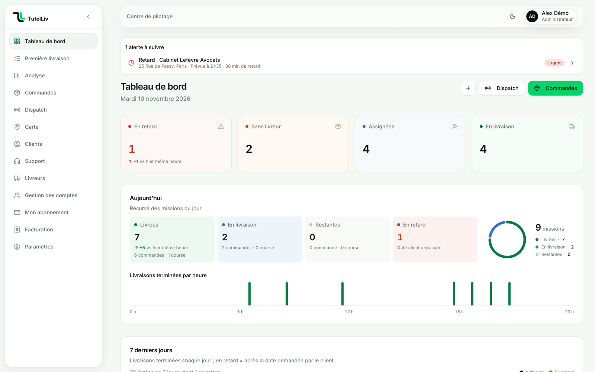
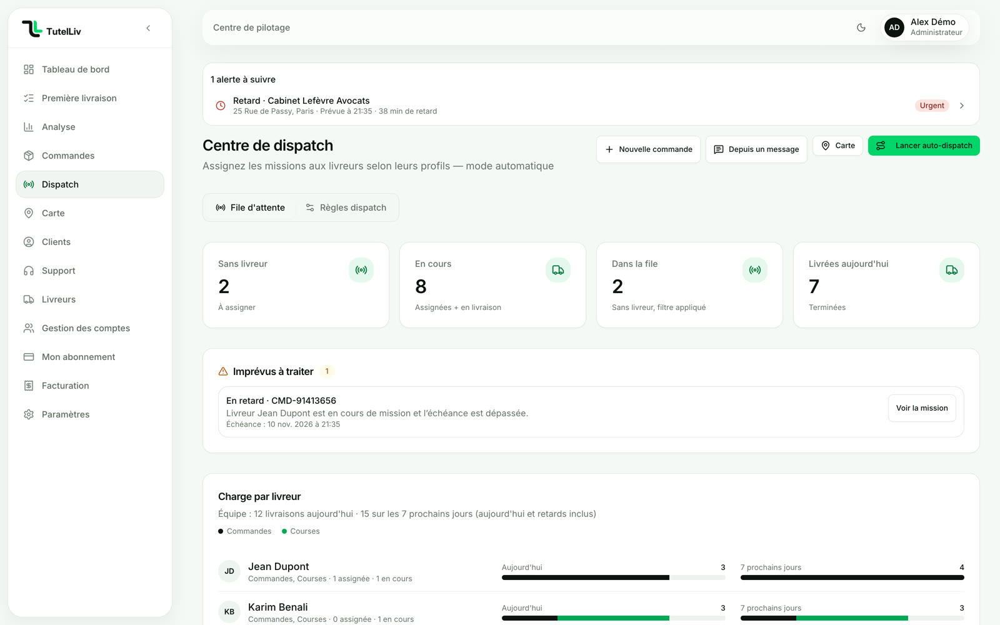
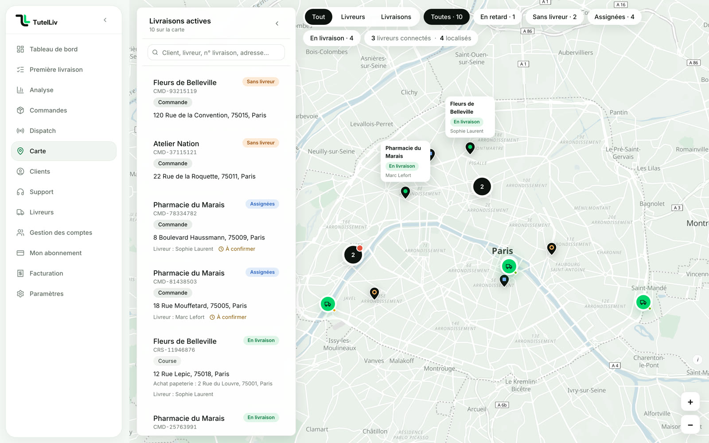
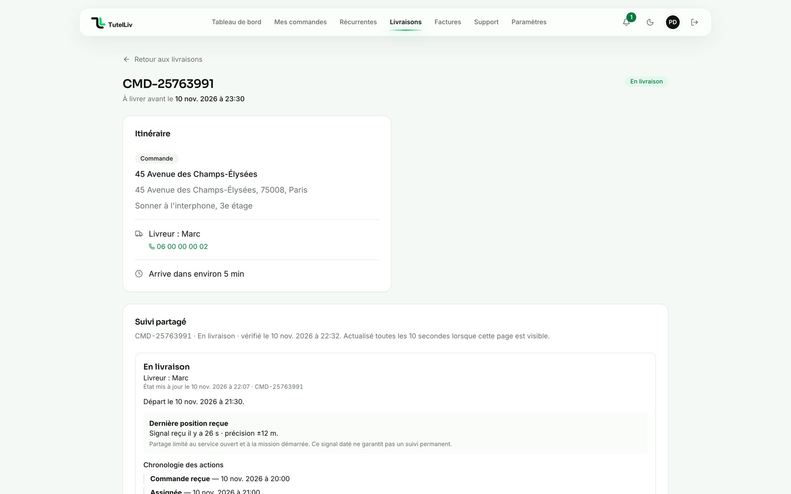
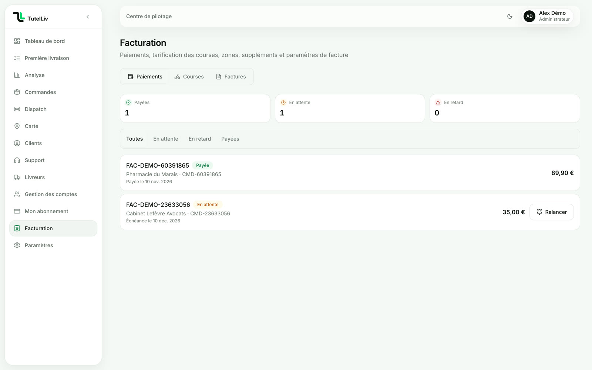
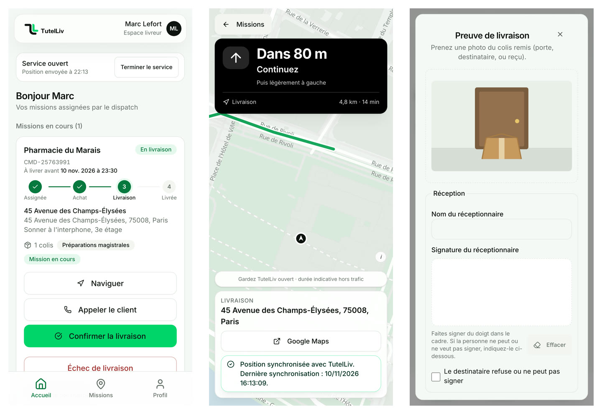

<div align="center">

<picture>
  <source media="(prefers-color-scheme: dark)" srcset="public/brand/logo-horizontal-fond-sombre.png">
  
</picture>

### Le logiciel des entreprises de livraison B2B

Commandes, dispatch, suivi en direct, preuve de livraison et facturation, au même endroit.<br>
Un espace pour l'entreprise, un pour ses clients, un pour ses livreurs.

[**Essayer la démo**](https://tutelliv.fr/demo) · [Site](https://tutelliv.fr) · [Documentation](docs/README.md)

[](https://github.com/orsocrtnt/tutelliv/actions/workflows/ci.yml)


<br>



</div>

## En bref

TutelLiv est un SaaS multi-entreprise pour centraliser les commandes de livraison, l'affectation des chauffeurs, les échanges, le suivi daté, les preuves et l'historique. Il remplace les appels, les SMS et le tableur par un seul outil, partagé par trois espaces :

| Espace | Pour qui | Ce qu'on y fait |
| --- | --- | --- |
| **Entreprise** | Le dirigeant et le dispatch | Recevoir les commandes, affecter les livreurs, suivre la journée sur la carte, facturer |
| **Client** | Les clients de l'entreprise | Commander seul, répéter une commande chaque semaine, suivre sa livraison sans appeler |
| **Livreur** | Les chauffeurs | Voir ses missions, se guider, livrer avec photo et signature, signaler un imprévu, sans application à installer |

Chacun ne voit que ce qui le concerne.

## Aperçu

_Captures de la [démonstration publique](https://tutelliv.fr/demo) : données fictives._

<table>
  <tr>
    <td width="50%"><br><b>Dispatch</b> : une seule file d'attente, un livreur choisi en un clic, ou proposé par TutelLiv.</td>
    <td width="50%"><br><b>Carte</b> : toutes les livraisons et tous les livreurs de la journée, en direct.</td>
  </tr>
  <tr>
    <td width="50%"><br><b>Espace client</b> : l'état de la livraison, le livreur et l'heure d'arrivée, sans appeler.</td>
    <td width="50%"><br><b>Facturation</b> : factures issues des livraisons, paiements suivis, relance en un clic.</td>
  </tr>
</table>

<p align="center">
  <br>
  <b>Espace livreur</b> : missions du jour, guidage jusqu'à l'adresse, confirmation avec preuve.
</p>

## Pour les contributeurs

L'état et l'ordre du travail sont suivis dans [`TODO.md`](TODO.md). Les instructions persistantes destinées aux contributeurs et agents se trouvent dans [`AGENTS.md`](AGENTS.md).

## Démarrage local

Version attendue : Node.js 22.18 (`.nvmrc`, champ `engines` de `package.json`, CI GitHub Actions), npm 10.9. Avec nvm : `nvm use`. Une autre version n'est pas bloquée (`engine-strict` désactivé) mais npm affiche un avertissement. Dans Vercel, régler « Node.js Version » du projet sur 22.x (action du propriétaire).

```bash
npm ci
cp .env.example .env.local
npm run check
npm run dev -- --hostname 127.0.0.1 --port 3106
```

Ne pas écraser un fichier `.env.local` existant. Avant le premier démarrage authentifié, remplacer les valeurs d'exemple par les accès d'un environnement de développement identifié. Le site est alors disponible sur `http://127.0.0.1:3106`.

`npm run dev` régénère le client Prisma si le schéma a changé, sans modifier la base. Les commandes `db:push`, `db:sync-schema`, `db:migrate` et les seeds écrivent dans la base et ne font jamais partie d'un démarrage normal.

## Vérifications

```bash
npm run typecheck       # TypeScript
npm run lint            # ESLint sur le code applicatif, zéro avertissement admis
npm test                # règles locales sans service externe
npm run check           # typecheck + lint + tests locaux
npm run audit:prod      # vulnérabilités des dépendances livrées
npm run test:v1         # recette locale, connectée et navigateur sur base de test
npm run test:ops01      # récurrences connectées sur fixtures isolées
npm run test:special1   # socle missions spéciales sur fixtures isolées
npm run test:demo1      # deux démonstrations isolées et reset limité
npm run build           # build de production, serveur dev arrêté
```

La recette V1 crée uniquement des fixtures identifiables, les supprime de façon ciblée et contrôle leur absence. Elle nécessite la base de test autorisée et Chrome/Chromium. Voir [`docs/operations/test2/README.md`](docs/operations/test2/README.md).

## Configuration

Les variables et procédures sont décrites dans [`docs/OPERATIONS.md`](docs/OPERATIONS.md). Les dépendances principales sont :

- Supabase Auth et Storage ;
- PostgreSQL via Prisma ;
- Resend, optionnel tant que les e-mails ne sont pas activés ;
- OpenStreetMap pour les tuiles, Géoplateforme/IGN pour le géocodage et un endpoint compatible OSRM pour les itinéraires.

Les services cartographiques publics actuellement configurés servent aux essais. Ils n'offrent pas les garanties nécessaires à un SaaS vendu. Voir [`docs/operations/map-providers.md`](docs/operations/map-providers.md).

## Architecture

- Next.js 15 App Router et TypeScript strict ;
- Tailwind CSS 4, composants Radix/shadcn ;
- TanStack Query pour les données client et Zustand pour l'état local ciblé ;
- services métier dans `src/domains/` ;
- routes HTTP dans `src/app/api/` ;
- Prisma pour tous les accès métier à PostgreSQL ;
- Supabase pour l'identité et le stockage privé des preuves.

Les données métier sont bornées par `companyId` et, selon le rôle, par le client propriétaire ou le chauffeur affecté. Les contrôles d'interface complètent les contrôles serveur ; ils ne les remplacent pas.

## Documentation

- [`docs/README.md`](docs/README.md) — index et statut des documents ;
- [`docs/ARCHITECTURE.md`](docs/ARCHITECTURE.md) — composants, flux et limites ;
- [`docs/DATABASE.md`](docs/DATABASE.md) — modèles, sécurité et commandes de schéma ;
- [`docs/RBAC.md`](docs/RBAC.md) — rôles et contrôles d'accès ;
- [`docs/OPERATIONS.md`](docs/OPERATIONS.md) — installation, configuration, dépannage et reprise ;
- [`docs/CONVENTIONS.md`](docs/CONVENTIONS.md) — conventions de contribution ;
- [`docs/RECETTE_V1.md`](docs/RECETTE_V1.md) — scénarios fonctionnels ;
- [`docs/VISION_PRODUIT_COMMERCIALE.md`](docs/VISION_PRODUIT_COMMERCIALE.md) — vision commerciale, avec hypothèses clairement séparées.

Les rapports datés dans `docs/rapports/` prouvent un état à leur date. Ils ne remplacent ni `TODO.md` ni la documentation courante.

## Limites avant vente

Le code et la recette locale ne constituent pas une mise en production. Une préproduction séparée, un historique de migrations reproductible, une restauration chronométrée, la configuration e-mail réelle, les essais iPhone/Android, les fournisseurs cartographiques avec garanties et les décisions juridiques/comptables restent ouverts dans `TODO.md`.
